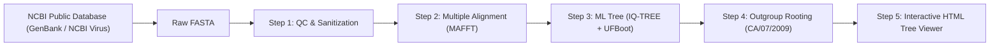

# Student Tutorial: Phylogenetic Sequence Analysis with Google Antigravity
## Case Study: From Sequences to Tree in Influenza A (H1N1pdm09)

---

## 1. Introduction: Why Antigravity for Bioinformatics?

Traditional bioinformatics workflows require students to memorize dozens of disparate CLI tools (`mafft`, `iqtree`, `fasttree`, `figtree`, `biopython`, `seqkit`), juggle syntax errors, troubleshoot missing flags, and struggle with file format incompatibilities (e.g. Newick vs Nexus, Phred headers, non-compliant characters).

**Google Antigravity** transforms this learning paradigm into an **AI-first, agentic pair-programming workflow**:
- **Autonomous Execution**: Antigravity does not merely give you snippets; it reads your local FASTA files, runs tools via bash, checks logs, and writes clean scripts.
- **Self-Healing Debugging**: If a tool fails (e.g., duplicate sequence IDs or missing outgroups), Antigravity detects the failure in the terminal, diagnoses the root cause, and patches the input data or command automatically.
- **Interactive Visual Feedback**: Antigravity can synthesize raw Newick trees and tabular metadata into modern, interactive web applications and reports directly in your workspace.

In this tutorial, you will learn how to pair program with Antigravity to perform an end-to-end phylogenetic analysis on **Influenza A (H1N1pdm09) Hemagglutinin (HA)** sequences from the 2009 pandemic root up to recent 2023–2025 clinical isolates.

---

## 2. Dataset Overview: Influenza A (H1N1pdm09)

Influenza A virus evolves rapidly through **antigenic drift** (point mutations in the Hemagglutinin HA and Neuraminidase NA surface glycoproteins) and **antigenic shift / reassortment** (exchange of viral genome segments).

In `data/h1n1/`, we have curated a representative 30-strain dataset spanning 16 years of viral evolution:
1. **Root Reference**: `A/California/07/2009` (The baseline reference strain of the 2009 pandemic).
2. **Historical WHO Vaccine Strain**: `A/Victoria/2570/2019` (Representative of clade 6B.1A.5a.2).
3. **Updated WHO Vaccine Strain**: `A/Victoria/4897/2022` (Representative of clade 6B.1A.5a.2a).
4. **Global Reference Clades**: Representative strains from 2020 to 2023 (e.g. `A/Wisconsin/14/2021`, `A/SouthDakota/34/2022`, `A/DistrictOfColumbia/8/2023`).
5. **Recent Clinical Isolates**: Clinical specimens collected in Taiwan between 2023 and 2025 (`A/Taiwan/V..._barcode...`).

---

## 3. The 6-Step Workflow: Step-by-Step with Antigravity



### Step 0: Searching and Downloading Sequences from the NCBI Public Database

Before building a phylogenetic tree, students must acquire authoritative reference sequences and surveillance isolates from the **NCBI Public Databases**.

#### 🌐 Where and How to Search on NCBI:
1. **NCBI Virus Portal**: [https://www.ncbi.nlm.nih.gov/labs/virus/](https://www.ncbi.nlm.nih.gov/labs/virus/)
   - **Virus**: Select `Influenza A virus` (`taxid:11320`).
   - **Serotype**: Select `H1N1`.
   - **Segment / Protein**: Filter by `Segment 4` or `Hemagglutinin (HA)`.
   - **Host**: Filter by `Homo sapiens (human)`.
   - **Completeness**: Filter for complete coding sequences (~1,700 bp).
2. **NCBI Nucleotide / GenBank**: [https://www.ncbi.nlm.nih.gov/nucleotide/](https://www.ncbi.nlm.nih.gov/nucleotide/)
   - Query by exact Accession numbers for international reference and WHO vaccine strains:
     - `CY121680.1`: **A/California/07/2009** (Root reference strain for H1N1pdm09).
     - `OQ719015.1`: **A/Victoria/2570/2019** (WHO 2019–2021 vaccine strain, Clade 5a.2).
     - `OQ718989.1`: **A/Victoria/4897/2022** (WHO 2022–2025 updated vaccine strain, Subclade 5a.2a).

#### 💡 Student Prompt to Antigravity:
> *"Antigravity, please query the NCBI public database (GenBank / NCBI Nucleotide) and download the reference sequences for A/California/07/2009 (CY121680.1), A/Victoria/2570/2019 (OQ719015.1), and A/Victoria/4897/2022 (OQ718989.1) into `data/h1n1/ncbi_fetched_references.fasta` using `scripts/fetch_ncbi_sequences.py` or BioPython Entrez."*

---

### Step 1: Sequence QC & Ambiguity Inspection

Before running an alignment, inspect the sequence integrity.

#### 💡 Student Prompt to Antigravity:
> *"Antigravity, please inspect `data/h1n1/h1n1_ha_unaligned.fasta` using Python. Report sequence count, min/max lengths, and check if any sequences contain excessive 'N' characters or non-standard nucleotide characters."*

#### What Antigravity Does:
Antigravity executes a script or runs `scripts/compare_alignment_qc.py` to check the dataset:
- Total taxa: 30
- Length range: ~1,700 bp (full coding sequence of HA)
- Base composition: ~41% GC content, ~35% Adenine (typical for Influenza A)

---

### Step 2: Multiple Sequence Alignment (MSA) with MAFFT

Alignment is the cornerstone of phylogenetics. We align homologous sites across all 30 strains so that site-by-site evolutionary changes can be compared.

#### 💡 Student Prompt to Antigravity:
> *"Please align `data/h1n1/h1n1_ha_unaligned.fasta` using MAFFT. Save the output to `data/h1n1/h1n1_ha_aligned.fasta`. After alignment, summarize how many constant sites, variable sites, and parsimony-informative sites exist in the alignment."*

#### Technical Insight:
- MAFFT uses Fast Fourier Transform (FFT) to quickly find homologous segments.
- Running `scripts/compare_alignment_qc.py` reveals:
  - **Constant Sites**: ~88.3% (conserved framework of Hemagglutinin)
  - **Parsimony-Informative Sites**: ~4.9% (sites containing phylogenetic signal shared by $\ge 2$ taxa)

---

### Step 3: Maximum Likelihood Tree Inference with IQ-TREE

We use **IQ-TREE**, a gold-standard Maximum Likelihood (ML) phylogenetic software.

#### 💡 Student Prompt to Antigravity:
> *"Reconstruct a Maximum Likelihood phylogenetic tree from `data/h1n1/h1n1_ha_aligned.fasta` using IQ-TREE. Use the GTR+G substitution model with 1,000 ultrafast bootstrap replicates (-B 1000). Save the output with prefix `outputs/h1n1_ha_tree`."*

#### Key Parameters Explained:
1. **GTR+G (General Time Reversible + Gamma)**:
   - GTR allows all 6 pairwise nucleotide substitution rates ($A \leftrightarrow C, A \leftrightarrow G, \dots$) to differ.
   - Gamma distribution ($\Gamma$) models rate heterogeneity across sites (some residues mutate rapidly, others are strongly constrained).
2. **Ultrafast Bootstrap (UFBoot, -B 1000)**:
   - Measures branch reliability. Branches with UFBoot $\ge 95\%$ are statistically well-supported.

---

### Step 4: Outgroup Rooting on `A/California/07/2009`

Standard Maximum Likelihood trees are time-reversible and mathematically **unrooted**. Without a biological root, you cannot determine which lineages are ancestral and which are derived!

#### 💡 Student Prompt to Antigravity:
> *"Re-root the generated tree `outputs/h1n1_ha_tree.treefile` using `A/California/07/2009_REF_NextstrainRoot` as the outgroup. Explain how rooting establishes the evolutionary direction toward the 2023-2025 strains."*

#### Biological Insight:
Because the 2009 pandemic H1N1 virus entered the human population in spring 2009, placing `A/California/07/2009` at the root polarizes all mutations, showing how subsequent lineages accumulated mutations over time (2019 $\rightarrow$ 2022 $\rightarrow$ 2025).

---

### Step 5: Interactive Visualization & Antigenic Clade Discovery

Viewing trees in static images or raw text files obscures metadata. Antigravity can synthesize an interactive web dashboard!

#### 💡 Student Prompt to Antigravity:
> *"Generate an interactive HTML visualization for our rooted tree using `scripts/render_tree_interactive.py` with metadata from `data/h1n1/h1n1_ha_metadata.tsv`. Open or point me to `outputs/h1n1_interactive_tree.html`."*

#### Interactive Features to Explore in `outputs/h1n1_interactive_tree.html`:
1. **Phylogram vs Cladogram**: Toggle between true branch lengths (genetic divergence) and uniform cladogram branch lengths.
2. **Search Bar**: Type `Taiwan` or `Vaccine` to instantly highlight matching branches in glowing cyan.
3. **Node Inspector Panel**: Click on any leaf node to see the strain name, collection date, geographic region, and accession ID.
4. **Bootstrap Support**: Numbers on internal nodes indicate ultrafast bootstrap percentages.

---

## 4. Biological Discussion: Did the Vaccine Keep Pace?

Examine the topology in `outputs/h1n1_interactive_tree.html`:

1. **The 2019 Vaccine (`A/Victoria/2570/2019`)**:
   - Located on an earlier branch belonging to **clade 5a.2**.
   - Notice the substantial branch length separating it from the 2023–2025 clinical isolates.

2. **The 2022 Vaccine (`A/Victoria/4897/2022`)**:
   - Located within **subclade 5a.2a**.
   - It clusters much closer to the modern clinical specimens (`barcode15`, `barcode16`, `barcode18`, `barcode17`, etc.).

3. **Public Health Conclusion**:
   - The phylogenetic tree visually demonstrates the necessity of the WHO's annual vaccine composition update: strains circulating in 2024–2025 had drifted significantly beyond the reach of the 2019 vaccine, aligning closely with the updated 5a.2a/5a.2a.1 vaccine formulation.

---

## 5. Automated Single-Script Execution

To run the entire pipeline with a single command:
```bash
python3 scripts/run_pipeline.py \
    --input data/h1n1/h1n1_ha_unaligned.fasta \
    --meta data/h1n1/h1n1_ha_metadata.tsv \
    --outdir outputs \
    --threads 4
```

View the interactive tree immediately by opening `outputs/interactive_tree.html` in your web browser!

---

## 6. Student Exercises & Challenges

### Exercise 1: Alignment Quality Inspection
Run `python3 scripts/compare_alignment_qc.py data/h1n1/h1n1_ha_aligned.fasta`.
- What percentage of alignment sites are parsimony-informative?
- Why does `A/California/07/2009` have a higher gap percentage than recent strains? (Hint: compare partial HA1 sequencing vs complete CDS).

### Exercise 2: ModelFinder Comparison
Prompt Antigravity to run IQ-TREE with automatic model selection (`-m MFP`) instead of `GTR+G`.
- Did ModelFinder choose `GTR+F+I+G4`, `TIM2+F+R2`, or another substitution model?
- Does the choice of model alter the branching order of the 2024–2025 clinical isolates?

### Exercise 3: Prompting Antigravity for Custom Visualizations
Prompt Antigravity to add a new color category or feature to `scripts/render_tree_interactive.py`, such as highlighting strains by collection year (2009–2019 vs 2020–2023 vs 2024–2025).
